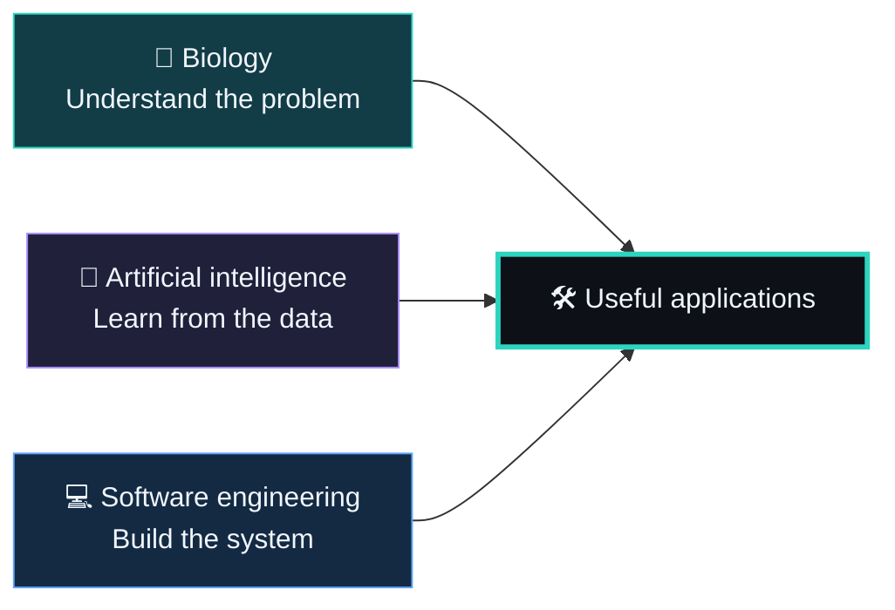

<!--
  PROFILE SETUP
  Copy this file into elhaouchomar/elhaouchomar as README.md.
  Banner, typing animation, badges, and icons are served by external services.
  The text, project links, and diagrams remain useful if those services are unavailable.
-->

<p align="center">
  
</p>

<h1 align="center">Biology trained my eye. Code expanded my reach.</h1>

<p align="center">
  <strong>AI &amp; Software Engineer · Medical Biology Background</strong><br />
  Building useful things where science, data, and software meet.
</p>

<p align="center">
  <a href="https://omario.me">
    
  </a>
</p>

<p align="center">
  <a href="https://omario.me"></a>
  <a href="https://www.linkedin.com/in/omar-el-haouch/"></a>
  <a href="mailto:elhaouchomar@gmail.com"></a>
</p>

---

### 🧬 The origin story

My path into engineering started in medical biology: microbiology, biochemistry, and molecular diagnostics. Today, I bring that scientific mindset to machine learning, bioinformatics, and full stack development.

I like understanding the whole problem: the data, the model, the API, and the person who will actually use the result.

```python
class Omar:
    background = "Medical biology & laboratory science"
    builds = ["AI applications", "Full stack software", "Bioinformatics pipelines"]
    interests = ["Computer vision", "LLMs & RAG", "Healthcare", "Quantitative finance"]
    speaks = {"French": "fluent", "English": "professional"}

    def approach(self, problem):
        return "Observe → question → experiment → build → improve"
```

### ⚡ Three worlds. One workspace.



### 🚀 Things I've built

<table>
  <tr>
    <td width="50%" valign="top">
      <h3>🧬 BioFlow</h3>
      <p>From bacterial sequencing data to a report: quality control, assembly, annotation, and antimicrobial resistance analysis.</p>
      <p><code>Go</code> <code>Docker</code> <code>Bioinformatics</code></p>
      <a href="https://github.com/elhaouchomar/bioflow">Explore the pipeline →</a>
    </td>
    <td width="50%" valign="top">
      <h3>📊 Credit Scoring</h3>
      <p>Credit risk exploration, feature engineering, model evaluation, and SHAP explanations with an interactive dashboard.</p>
      <p><code>Python</code> <code>LightGBM</code> <code>SHAP</code></p>
      <a href="https://github.com/elhaouchomar/credit-scoring">Explore the models →</a>
    </td>
  </tr>
  <tr>
    <td width="50%" valign="top">
      <h3>💬 Social Network</h3>
      <p>Profiles, followers, groups, live chat, and notifications in a full stack social application.</p>
      <p><code>Go</code> <code>Next.js</code> <code>WebSockets</code></p>
      <a href="https://github.com/elhaouchomar/social-network">Explore the application →</a>
    </td>
    <td width="50%" valign="top">
      <h3>👁️ Emotions Detector</h3>
      <p>A facial emotion recognition project covering image preprocessing, CNN training, evaluation, and live inference.</p>
      <p><code>TensorFlow</code> <code>Keras</code> <code>OpenCV</code></p>
      <a href="https://github.com/elhaouchomar/emotions-detector">Explore the vision project →</a>
    </td>
  </tr>
</table>

**Also in my lab:** BacterioLab, an AI-powered mobile microbiology platform for reading antibiograms and laboratory test strips. See the [public overview in my portfolio](https://omario.me/myworks).

<p align="center">
  <a href="https://github.com/elhaouchomar?tab=repositories">More experiments, applications, and systems →</a>
</p>

### 🛠️ The instruments

<p align="center">
  <br />
  <br />
  
</p>

<p align="center">
  <sub>Plus Pandas, NumPy, scikit-learn, Jupyter, and a habit of asking why.</sub>
</p>

### 🔎 A little deeper

<details>
  <summary><strong>Open the lab notebook</strong></summary>

<br />

| Lens | What draws me in |
| :--- | :--- |
| 🧠 AI & data | Computer vision, explainable models, retrieval augmented generation |
| 🧬 Biology | Microbiology, molecular biology, bacterial sequencing, medical data |
| ⚙️ Engineering | APIs, real-time applications, systems programming, containers |
| 📈 Beyond the lab | Quantitative finance and algorithmic strategies |

My engineering projects range from a [Unix-style shell in Rust](https://github.com/elhaouchomar/0-shell) to a [nonblocking HTTP server in Java](https://github.com/elhaouchomar/java-localserver) and a [JavaScript framework built from scratch](https://github.com/elhaouchomar/mini-framework).

Different domains, same instinct: open the box and understand how it works.

</details>

---

<p align="center">
  <strong>Have an interesting problem at the intersection of science and software?</strong><br />
  <a href="mailto:elhaouchomar@gmail.com">Let's build something useful.</a>
</p>

<p align="center">
  <code>observe.</code> &nbsp; <code>experiment.</code> &nbsp; <code>build.</code> &nbsp; <code>repeat.</code>
</p>


